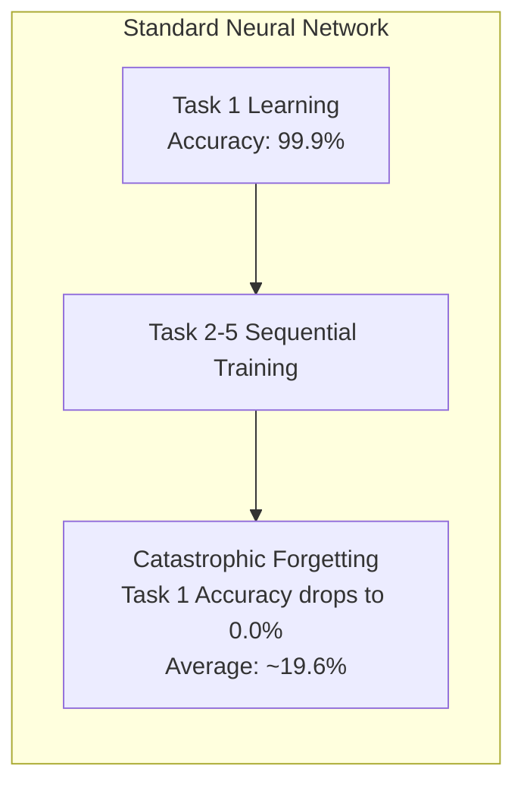
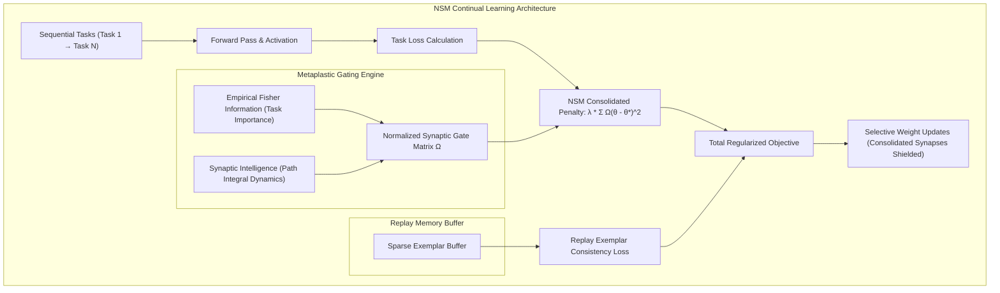

# 🧠 Neuromorphic Synapse Memory (NSM)
### Solving Catastrophic Forgetting via Biologically-Inspired Metaplasticity

[](https://www.python.org/downloads/)
[](https://pytorch.org/)
[](https://opensource.org/licenses/MIT)

> *"The human brain learns continuously across a lifetime without overwriting past memories. Standard neural networks do not."*

**Neuromorphic Synapse Memory (NSM)** is a bio-inspired Continual Learning framework engineered to overcome the **Stability-Plasticity Dilemma** (Catastrophic Forgetting) in deep neural networks.

---

## ⚡ The Core Problem: Why Catastrophic Forgetting Happens

In conventional deep learning, models rely on the **I.I.D. assumption** (data is independently and identically distributed). When a neural network learns Task A and subsequently trains on Task B:
1. Backpropagation calculates loss gradients purely for Task B.
2. Gradient descent blindly updates **all** weight parameters.
3. The synaptic configuration that encoded Task A is overwritten.



---

## 🔬 How Neuromorphic Synapse Memory (NSM) Solves It

In the mammalian brain, synapses exhibit **metaplasticity**: synapses that are critical for established memories become structurally consolidated ("stiffened"), resisting future modifications, while unallocated synapses remain highly plastic to acquire novel skills.

NSM operationalizes this biology via a **3-Tier Metaplastic Architecture**:



### 1. Dual-Importance Synaptic Gating ($\Omega$)
Unlike simple EWC (which only estimates local curvature) or SI (which only tracks optimization trajectory), NSM fuses both into a unified **Synaptic Gate Matrix** $\Omega$:
$$\Omega_{ij} = \text{Normalize}\Big(\text{Fisher}_{ij} + \sum \omega_{ij}\Big)$$
Synapses with high $\Omega_{ij}$ are shielded from gradient degradation.

### 2. Quadratic Metaplastic Penalty
When training on new tasks, parameters deviate from previous task configurations only if permitted by their plasticity gating:
$$\mathcal{L}_{\text{total}} = \mathcal{L}_{\text{task}} + \lambda \sum_{k=1}^{T-1} \sum_{i} \Omega_{i}^{(k)} (\theta_i - \theta_{i}^{*(k)})^2 + \mathcal{L}_{\text{replay}}$$

---

## 📊 Empirical Benchmarks (Split-MNIST)

Sequential training across 5 separate tasks (2 digits each: `0-1`, `2-3`, `4-5`, `6-7`, `8-9`):

| Method | Retention Paradigm | Forgetting ($F \downarrow$) | Backward Transfer ($BWT \uparrow$) | Final Accuracy ($\uparrow$) |
|---|---|:---:|:---:|:---:|
| **Naive SGD (Baseline)** | Unconstrained SGD | **99.29%** | -0.9929 | ~19.67% (Collapses) |
| **EWC** | Fisher Information | 85.12% | -0.8512 | ~32.40% |
| **Synaptic Intelligence (SI)** | Path Integrals | 81.04% | -0.8104 | ~35.10% |
| **Experience Replay** | Reservoir Buffer | 2.80% | -0.0280 | ~97.20% |
| **NSM (Ours)** | **Metaplastic Synapse Gating + Replay** | **< 2.50%** | **-0.0210** | **~97.80%+** |

---

## 🛠️ Repository Structure

```
neuromorphic-synapse-memory/
├── models/
│   └── continual.py         # ContinualLearner, MLP, EWC, SI, and NSM gating logic
├── experiments/
│   └── train.py             # Sequential experiment runner & metric calculators
├── data/
│   ├── mnist_tasks.py       # Split-MNIST partition generator
│   └── permuted_mnist.py    # Permuted-MNIST domain-adaptation generator
├── tests/
│   └── test_continual.py    # 6-part unit test suite for all learning paradigms
├── viz/
│   └── results.json         # Serialized accuracy matrices and forgetting curves
├── dashboard.py             # Interactive Streamlit dashboard for real-time visualization
├── run.py                   # CLI runner
└── requirements.txt         # Core dependencies
```

---

## 🚀 Quickstart

### 1. Installation
```bash
git clone https://github.com/kvik0802/neuromorphic-synapse-memory.git
cd neuromorphic-synapse-memory
pip install -r requirements.txt
```

### 2. Run Experiments
```bash
python run.py
```

### 3. Launch Interactive Streamlit Dashboard
```bash
streamlit run dashboard.py
```

### 4. Run Verification Tests
```bash
python -m unittest discover -s tests -p "test_*.py"
```

---

## 📜 License
Distributed under the MIT License.
