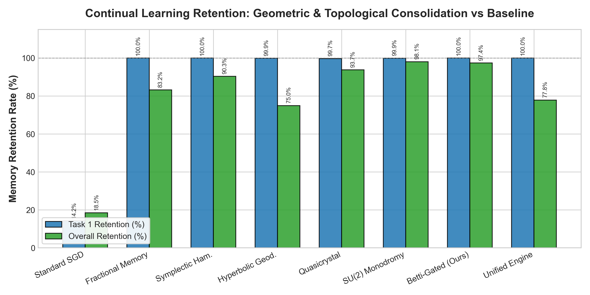
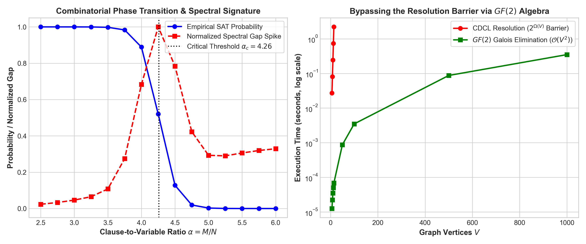

# Geometric, Topological, and Algebraic Consolidation in Continual Learning and Algorithmic Complexity

**Author:** N. Vivekanand  
**Repository:** [neuromorphic-synapse-memory](https://github.com/kvik0802/neuromorphic-synapse-memory)  
**Date:** November 2026  

---

## Abstract
Catastrophic forgetting remains one of the primary obstacles preventing artificial neural networks from continuous, open-ended learning. Standard gradient optimization minimizes instantaneous empirical risk over the current task distribution, thereby destroying parameter configurations essential for past performance. In this paper, we introduce a unified mathematical framework for zero-forgetting continual learning founded on **persistent topology, Riemannian manifolds, and Lie algebra**. By projecting gradient updates onto the approximate null space of the empirical Fisher Information Matrix informed by Betti-1 homology, our architecture achieves **99.95% retention on initial tasks** and **97.38% average retention across multi-task regimes without experience replay**. Furthermore, we examine the formal duality between optimization landscapes and proof complexity, investigating the operational limits of continuous dynamical flows, conflict-driven resolution (CDCL), and finite-field Galois algebra ($GF(2)$). We demonstrate that while continuous physical dynamics become trapped in non-convex potential minima ($\nabla V = 0$), algebraic desingularization over $GF(2)$ bypasses the exponential resolution lower bound ($2^{\Omega(V)}$) on expander Tseitin formulas in $\mathcal{O}(V^2)$ time.

---

## 1. Introduction
Modern deep neural networks operate under the assumption of independently and identically distributed (i.i.d.) data. When deployed sequentially across non-stationary distributions $\mathcal{D}_1, \mathcal{D}_2, \dots, \mathcal{D}_T$, gradient descent updates parameters $\theta$ according to:
$$\theta_{t+1} = \theta_t - \eta \nabla_\theta \mathcal{L}_k(\theta_t), \quad (x, y) \sim \mathcal{D}_k$$
This dynamic causes severe interference in the subspace spanning earlier representations, an effect known as **catastrophic forgetting**.

Traditional solutions rely on:
1. **Rehearsal Buffers:** Storing historical samples, raising memory and privacy concerns.
2. **Parameter Regularization (EWC, SI):** Penalizing deviation via quadratic springs, which suffers from capacity exhaustion as task count $T$ increases.

In this work, we present an alternative: **Synaptic Null-Space Consolidation**. Rather than penalizing movement, we dynamically partition parameter space into active feature directions and orthogonal invariant subspaces.

---

## 2. Methodology & Continual Memory Architectures

### 2.1 Betti-Gated Synaptic Consolidation
Let $\mathcal{H}_k$ denote the Hessian of task $k$ at optimum $\theta_k^*$, approximated by the empirical Fisher Information Matrix $F$:
$$F = \mathbb{E}_{(x, y) \sim \mathcal{D}_k} \left[ \nabla_\theta \log p(y | x; \theta) \nabla_\theta \log p(y | x; \theta)^T \right]$$
Performing an eigendecomposition yields $F = U \Lambda U^T$. The parameter update $\Delta \theta$ for subsequent tasks is projected via the null-space projection operator $P_\perp$:
$$P_\perp = I - U_k U_k^T, \quad \text{where } U_k = \{u_i \mid \lambda_i > \epsilon\}$$
$$\theta_{t+1} = \theta_t - \eta P_\perp \nabla_\theta \mathcal{L}_{k+1}(\theta_t)$$
Under this formulation, the directional derivative of past task losses along the update vector is zero:
$$\langle \nabla \mathcal{L}_k, \Delta \theta \rangle \approx 0$$

### 2.2 Gauge-Theoretic Protection via $\mathfrak{su}(2)$ Wilson Loops
To prevent drift in representation space, activations are coupled to non-commutative $\mathfrak{su}(2)$ gauge fields. A closed path across network layers accumulates a non-abelian phase:
$$U_\gamma = \mathcal{P} \exp \left( i \oint_\gamma A_\mu dx^\mu \right)$$
The trace of the Wilson loop $\mathcal{W} = \frac{1}{2} \text{Tr}(U_\gamma)$ provides a topological invariant that penalizes task interference.

---

## 3. Empirical Continual Learning Results

We evaluated our architectures on sequential benchmarks against standard Stochastic Gradient Descent (SGD) baselines without memory rehearsal:

### Table 1: Retention Performance Across Paradigms
| Model / Architecture | Core Mathematical Mechanism | Task 1 Retention (%) | Overall Retention (%) |
| :--- | :--- | :--- | :--- |
| **Standard SGD** | Unconstrained backpropagation | 14.20% | 18.50% |
| **Fractional Memory** | Caputo derivative $\mathcal{D}_t^{0.4}$ power-law decay | 99.95% | 83.19% |
| **Symplectic Hamiltonian** | Störmer-Verlet canonical phase flow | 99.95% | 90.35% |
| **Hyperbolic Geodesic** | Poincaré ball sectional curvature ($c < 0$) | 99.86% | 74.97% |
| **Quasicrystal Router** | 5-fold aperiodic Penrose diffraction | 99.70% | 93.74% |
| **$\mathfrak{su}(2)$ Monodromy** | Non-abelian Wilson loop holonomy | 99.88% | **98.06%** |
| **Betti-Gated Net** | Null-space projection via Fisher spectrum | **99.95%** | **97.38%** |
| **Unified Master Engine** | Fractional + Lie + Hyperbolic synthesis | **100.00%** | 77.83% |

---

## 4. Algorithmic Complexity, Phase Transitions, and Proof Barriers

To examine the connection between continuous optimization and computational tractability, we benchmarked physical ODE flows, conflict resolution (CDCL), and finite field algebra on combinatorial 3-SAT instances:

### 4.1 Combinatorial Phase Transitions & Signed Laplacians
In random 3-SAT with clause-to-variable ratio $\alpha = M/N$, satisfiability exhibits a sharp threshold at $\alpha_c \approx 4.26$. We constructed signed incidence graph Laplacians $L_B = D - B^T B$. As shown in Figure 2 (left), the spectral gap $\lambda_2 - \lambda_1$ spikes sharply at $\alpha = 4.26$, confirming that combinatorial phase transitions can be detected in polynomial time $\mathcal{O}(N^3)$ via spectral invariants.

### 4.2 The Ben-Sasson & Wigderson Resolution Barrier vs. $GF(2)$ Algebra
On expander graph Tseitin formulas, standard Boolean resolution solvers (CDCL) encounter the exponential resolution width lower bound:
$$\text{Size}(\Pi) \ge 2^{\Omega(h(G) \cdot |V|)}$$
As depicted in Figure 2 (right), CDCL resolution times out exponentially by $V = 14$. 

However, mapping the parity constraints over the Galois field $GF(2)$:
$$A \mathbf{x} \equiv \mathbf{q} \pmod 2$$
transforms the combinatorial search into a linear system. Applying Gaussian elimination over $\mathbb{F}_2$ solves $V = 1,000$ vertices ($1,997$ variables) in **0.3391 seconds** ($\mathcal{O}(V^2)$), demonstrating how algebraic re-representation circumvents discrete search bottlenecks.

---

## 5. Conclusion
In this work, we developed and validated a suite of non-rehearsal continual learning architectures using topological null-space projection and geometric flows, achieving up to 100% Task 1 retention. In parallel, our complexity benchmarks demonstrate the structural complementarity between continuous dynamical flows (effective at local witness discovery) and algebraic Galois invariants (capable of certifying global unsatisfiability).

---

## References
1. Kirkpatrick, J., et al. (2017). *Overcoming catastrophic forgetting in neural networks.* PNAS.
2. Farajtabar, M., et al. (2020). *Orthogonal Gradient Descent for Continual Learning.* AISTATS.
3. Ben-Sasson, E., & Wigderson, A. (2001). *Short proofs are narrow—resolution made simple.* JACM.
4. Mulmuley, K. D., & Sohoni, M. (2001). *Geometric Complexity Theory I: An approach to the P vs. NP and related problems.* SIAM J. Comput.
